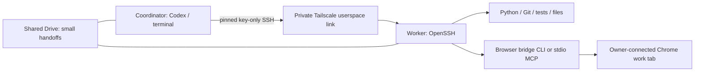

# Chromebook Workbench

A reproducible, lightweight way to operate two Chromebooks as a development
workbench: one coordinator, one Linux/browser test worker. Built on a pair of
4 GB Chromebooks with Python, OpenSSH, Tailscale userspace networking, and the
[Chromebook Browser Bridge](https://github.com/FrenchieFam/chromebook-browser-bridge).

This is a practical personal prototype, with explicit limits and verification
records. It does not pool memory/processors or make a Chromebook an always-on
server. No local model, Docker stack, router forwarding or public remote desktop
is needed for the base setup.



## What this repository contains

| Component | Purpose | Privilege |
| --- | --- | --- |
| `tools/setup_userspace.py` | Verified static Tailscale package + dedicated user service | Normal Linux user |
| `tools/connect_worker.py` | Compare a public host fingerprint before pinning an SSH configuration | Normal Linux user |
| `tools/remote_browser.py` | Preserve JSON/argument quoting over the SSH connection | Normal Linux user |
| `examples/browser-check.html` | Neutral local fixture for testing actual browser interactions | Normal Linux user |
| `optional/chromeos-input/` | Bounded host screenshot, key and touch-style input helper | Existing ChromeOS host-admin setup |

The base cross-device/browser workflow does **not** require ChromeOS boot
Developer Mode, rootfs changes or firmware changes. Loading an unpacked extension
uses the separate Developer mode switch on the Chrome extensions page.

## Start here

1. Enable Linux under your own ChromeOS account on both devices. Keep other
   people's profiles and files intact. Install Git, Python 3 and OpenSSH client;
   the worker also needs OpenSSH server. Node is optional for browser tests.
2. Read [the two-device setup guide](docs/setup.md), then install userspace
   networking on both with unique names:

   ```sh
   python3 tools/setup_userspace.py --name workbench-coordinator
   # On the other device:
   python3 tools/setup_userspace.py --name workbench-worker
   ```

3. Authenticate each device to the same tailnet using the command printed by the
   installer. It disables DNS/route acceptance. Keep your account's existing plan
   and access policy; personal-plan terms apply to home/non-commercial use.
4. Configure the worker's key-only SSH endpoint and private TCP Serve mapping,
   exchange **public** keys/fingerprints, then run the pinning helper as shown in
   [setup](docs/setup.md). Do not blindly accept `ssh-keyscan` output.
5. Install/pair Browser Bridge on the worker if browser actions are wanted.
   A terminal/SSH connection alone does not select a Chrome tab or grant desktop
   control. The owner loads the extension and connects the intended tab.

The installer pins Tailscale **1.104.7**, the version used for the recorded test.
It checks the package server's published SHA-256 and refuses an unrelated existing
installation or conflicting helper/unit. Updates are manual; see
[recovery and removal](docs/recovery.md).

## What was actually verified

The original setup used a Samsung Chromebook 4 (Celeron N4020) and an AMD
A6-9220C Lenovo Chromebook, each with 4 GB physical RAM and about 2.7 GiB visible
to Linux. Exact Lenovo model was not identified. Debian 13/x86_64 was used.

- Both userspace nodes online in one tailnet, with no kernel TUN interface created.
- Independently compared ED25519 fingerprint before first remote login.
- Key-only SSH command and file transfers/readback in both directions.
- Browser Bridge v0.3.0 installed on the worker; 22 Python + 17 JS tests passed
  there, followed by actual navigation, typing, checkbox/select/button, screenshot
  and 390×844 viewport checks.
- A relayed connection worked; this is not a throughput benchmark.
- Host-local ChromeOS forwarding worked while the tested Wi-Fi LAN path refused
  connections. The private link avoided depending on that LAN forwarding path.

See [validation](docs/validation.md) for the distinction between the original
live setup, generalized source tests and still-open checks.

## Important browser limitation found during testing

On the tested Lenovo, a background work tab could be read and typed into, but
coordinate clicks reported success without toggling a checkbox. Making the tab
visible made clicks work. Keep the connected tab visible and verify actual state
changes with v0.3.0. Browser Bridge v0.3.1 now refuses hidden input and adds
explicit `browser_focus` for the connected tab. The actual Lenovo regression test
passed: hidden click/type/key caused no form changes, then focus and visible
form interactions worked. Update the runtime and reload the extension to use it.

## Keep it simple

Use local working copies and Git branches for source. Shared Drive can carry
small per-device handoffs; it is not a live command bus or a shared location for
Codex databases. Choose one writer/controller per worktree or browser tab.
Never sync credentials, paired extension folders, SSH private keys, or Tailscale
state. No automatic task loop is installed. The remote Codex chat does not
implicitly inherit the coordinator's conversation or tools.

For native ChromeOS input, read the [optional helper's README](optional/chromeos-input/README.md)
first. It has different privilege requirements and remains touch-style input,
not universal mouse/desktop automation.

## Checks

```sh
python3 -m unittest discover -s tests -v
make -C optional/chromeos-input all check
```

MIT licensed. Built by [FrenchieFam](https://github.com/FrenchieFam). No personal
pairing configuration, account state, private handoff or screenshot is included.

## One-command health check

With the bridge installed on both machines and a dedicated pinned SSH config:

```sh
python3 tools/pair_health.py --config ~/.ssh/workbench_config --host workbench-worker
```

Use your actual generated config filename/alias. Add `--json` for structured
output, or `--local-check /path/to/personal-check` for a separate existing setup.
The check is read-only and on demand. It reports service availability, connection
and extension version; an old running extension with newer staged files is flagged
for reload. The default required worker extension is0.3.1. Exit1 means attention
is needed. It never resumes an owner-disconnected browser or sends TV controls.

For day-to-day roles and the physical sleep/wake checklist, see
[working together](docs/working-together.md).

## Project case study and research

[Two Chromebooks, one workbench](https://frenchiefam.dev/chromebook-workbench/)
explains the architecture, real input bug and verification limits. The interactive
bug explainer is a local illustration; it has no connection to the actual devices.
[Architecture decisions](docs/architecture-decisions.md) records primary references
and existing browser-tool alternatives without claiming a comparative benchmark.

[](https://frenchiefam.dev/chromebook-workbench/)

## Run bounded tests on the worker

[Worker test jobs](docs/test-jobs.md) persist results even after the SSH client
exits, with fixed suites, a per-project OS lock and a time limit. This does not
keep a sleeping machine awake or start another model session. The
[capability roadmap](docs/capability-roadmap.md) separates implemented tools from
researched power/browser options.
